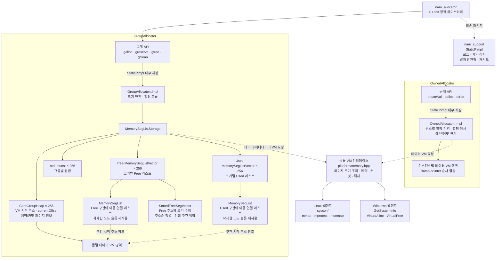
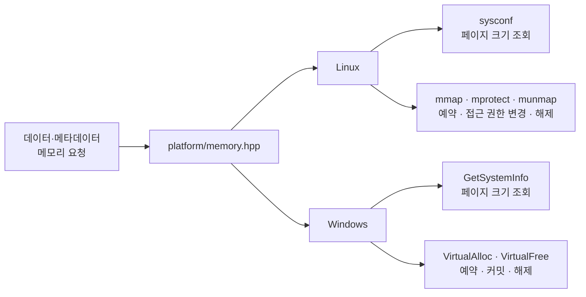
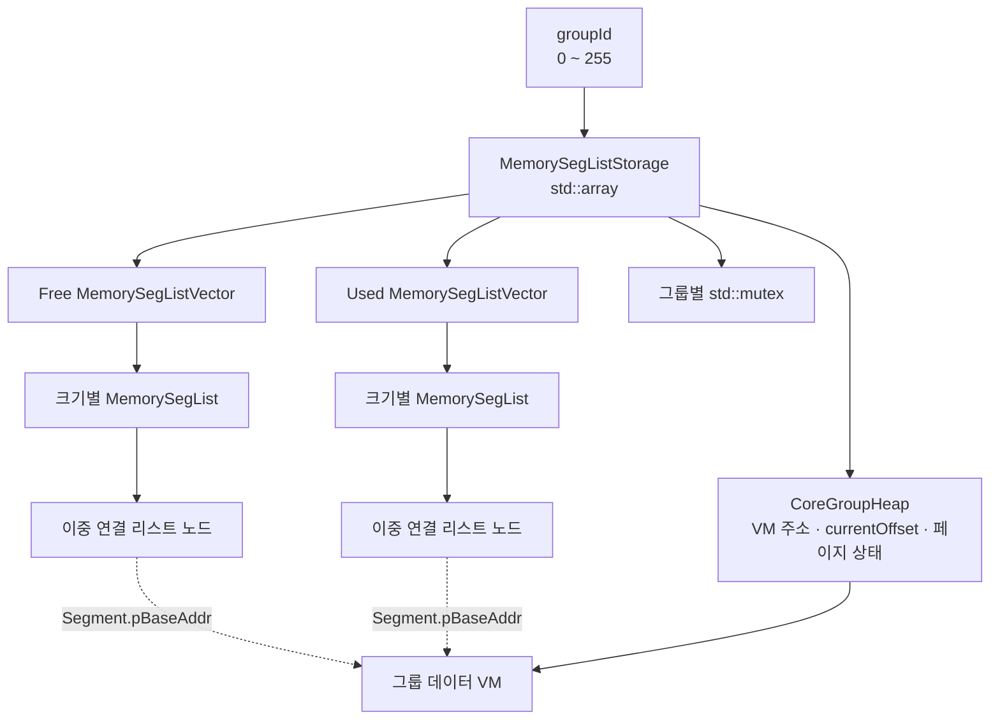
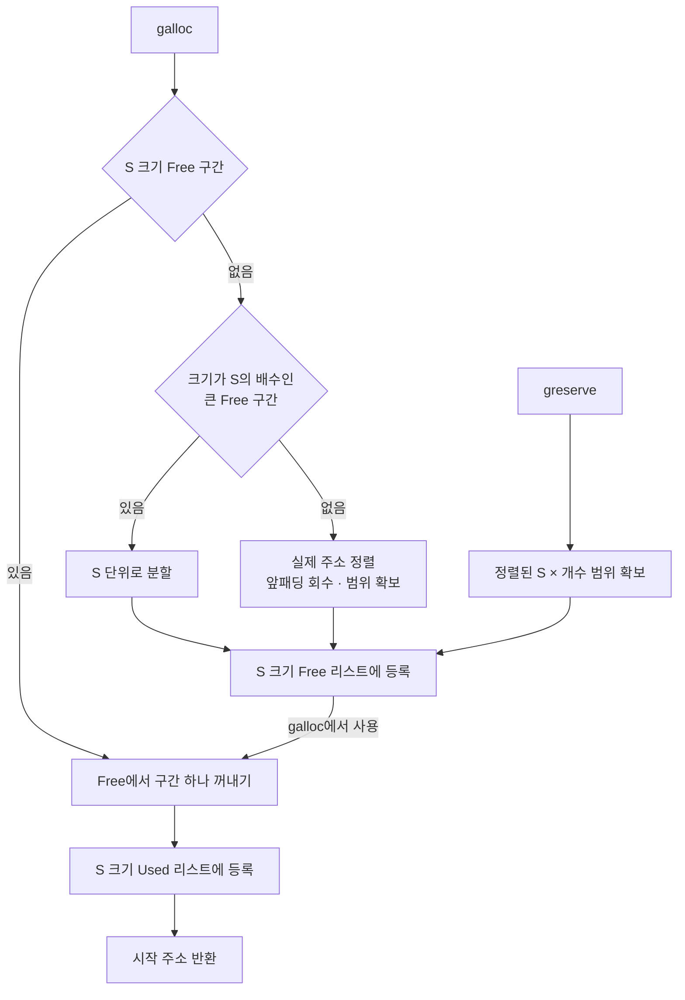
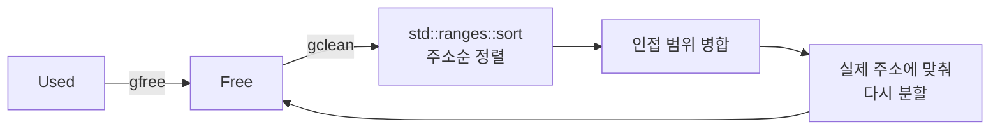
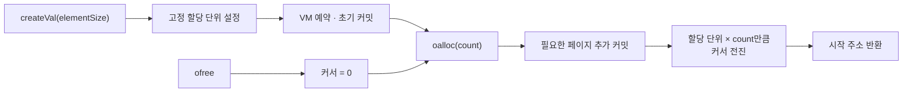
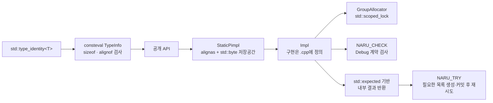
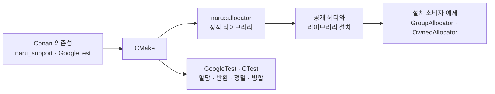

# naru_allocator

독립 C++23 정적 라이브러리 패키지. Conan 참조는 `naru_allocator/0.1.0`, CMake 타깃은 `naru::allocator`다.

## 아키텍처

Free·Used 리스트의 노드는 메타데이터용 VM에 저장되고, 각 노드가 가진 시작 주소가 그룹 데이터 VM의 구간을 가리킵니다.

## 상세 설명

**1. 가상 메모리 계층**

데이터와 메타데이터 저장공간을 OS 가상 메모리로 관리합니다. 페이지 크기를 조회해 예약·커밋 범위를 계산하고, 플랫폼별 시스템 호출을 공통 인터페이스로 감쌌습니다.

**2. GroupAllocator의 메타데이터 구조**

그룹 ID로 `std::array`를 인덱싱합니다. 각 그룹의 데이터 힙과 크기별 Free·Used 목록을 분리하고, 목록의 노드는 메타데이터용 VM에 배치합니다.

각 리스트는 제거된 노드 슬롯을 재사용 스택에 보관합니다. 새 노드가 필요하면 이 슬롯부터 사용합니다.

**3. 구간 할당과 재사용**

요청 크기를 16B 단위로 올린 `S`를 사용합니다. 실제 주소를 `std::uintptr_t`로 변환해 `% S`로 정렬을 계산합니다. 앞패딩은 Free 구간으로 회수하며, 분할 크기는 `std::bit_width()`와 `std::countr_zero()`로 선택합니다.

반환은 같은 크기의 목록 사이에서 주소를 이동합니다. 병합은 주소순으로 정렬한 Free 구간 중 맞닿은 범위만 대상으로 합니다.

**4. OwnedAllocator의 순차 할당**

원소 크기를 16B 단위로 올려 고정 할당 단위를 정합니다. Bump-pointer 방식으로 요청량만큼 커서를 이동하고, `ofree()`에서 커서를 시작점으로 되돌립니다.

**5. 인터페이스와 실행 제어**

`StaticPimpl`로 구현 타입을 `.cpp`에 두고, 구현 객체의 저장공간은 공개 객체 내부에 둡니다. `GroupAllocator`는 `consteval` 입력 타입으로 타입 크기와 지원 정렬을 확인합니다.

**6. 빌드와 검증**

CMake로 정적 라이브러리와 설치 대상을 구성하고, Conan으로 의존성을 선언합니다. GoogleTest·CTest와 설치 소비자 예제로 내부 동작과 공개 인터페이스를 검증합니다.

