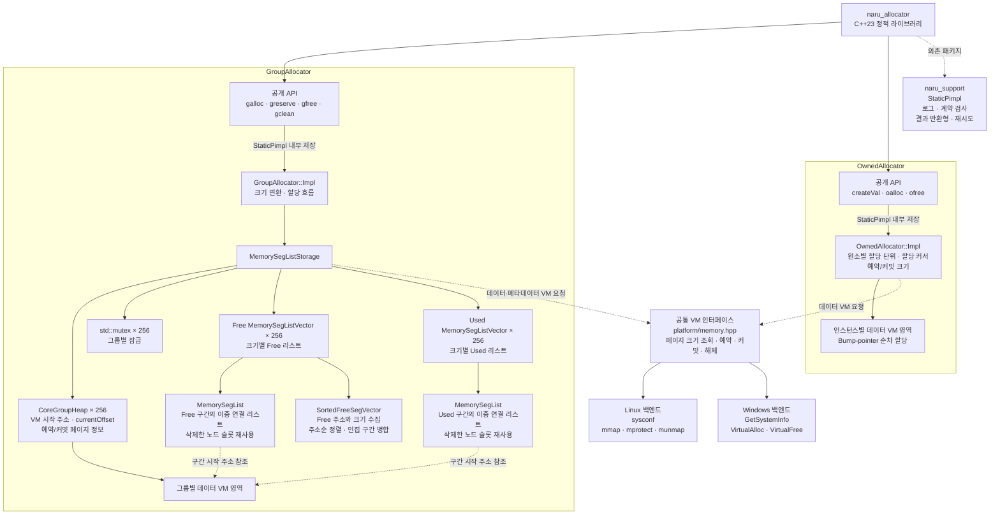

# naru_allocator

독립 C++23 정적 라이브러리 패키지. Conan 참조는 `naru_allocator/0.1.0`, CMake 타깃은 `naru::allocator`다.

## 아키텍처



Free·Used 리스트의 노드는 메타데이터용 VM에 저장되고, 각 노드가 가진 시작 주소가 그룹 데이터 VM의 구간을 가리킵니다.

## 상세 설명


MORU의 `libs/common/moru_allocator` 구현과 원본 테스트를 가져왔다. `moru`/`MORU`를 `naru`/`NARU`로, 기존 공통 오류 타입 참조를 `ErrorCode`로 바꿨다. 재시도 헤더의 include 경로는 `naru/support/retry.hpp`로 맞췄다.

메모리 시스템콜의 실패는 플랫폼 래퍼 안에서 OS 오류와 요청 정보를 기록한 뒤 `fatalExit()`로 종료한다. 정상 반환은 성공을 보장하며, `reserveCommonMemory()`는 `void*`, 커밋·디커밋·해제는 `void`를 반환한다. 호출부에서 `EX_*`로 시스템콜 오류를 전달받거나 성공 여부를 다시 검사하지 않는다. `MemoryState`와 `queryMemoryState()`는 각 플랫폼 메모리 구현의 익명 네임스페이스 안에서만 사용한다. Linux는 `/proc/self/maps`를 조회하며, 할당자 내부 규칙에 따라 매핑 없음은 `FREE`, `PROT_NONE`은 `RESERVED`, `PROT_READ | PROT_WRITE`는 `COMMITTED`로 판단한다. Linux의 상태 조회는 Debug `NARU_CHECK`에서 사용한다.

`releasePostCommitMemory()`와 `releaseEntireMemory()`는 `const VmMemoryInfo& pageInfo = {}`를 받는다. Windows에서는 이 인자를 사용하지 않으므로 생략할 수 있다. Linux에서는 `pageSize`와 `reservePageCount`에 최초 예약한 전체 영역의 정보를 반드시 전달한다.

Windows x64와 WSL Linux x64의 모노레포·독립 CMake 구성을 지원한다. Conan도 두 플랫폼을 허용한다. Windows 메모리 구현은 이식되어 있고, Linux에는 페이지 크기 조회·예약·보호 변경·영역 해제가 구현되어 있다. Linux의 `releasePostCommitMemory()`, `releaseEntireMemory()`는 `pageInfo.pageSize * pageInfo.reservePageCount`를 `munmap()`에 전달해 전체 예약 영역을 해제하며, 실패하면 OS 오류를 기록하고 치명 오류로 종료한다.

`naru::allocator::platform`은 모든 할당기에서 사용하는 OS 메모리 계층이다. 페이지 크기 조회·예약·커밋·디커밋·해제 선언은 `private/platform/memory.hpp`에, `VmMemoryInfo` 정의는 `private/platform/memory_types.hpp`에 둔다. 실제 OS 구현과 내부 상태 조회도 모두 `private/platform/`에 두며 플랫폼 헤더는 설치하지 않는다. `linux/linux_memory.cpp`는 `__linux__` 가드, Windows 소스는 `_WIN32` 가드를 사용한다. `VmMemoryInfo`는 기존 플랫폼별 타입 별칭을 유지한다.

```text
public/naru/
├── allocator.hpp
└── allocator/
    ├── group/group_allocator.hpp
    └── owned/owned_allocator.hpp
private/
├── group/
│   ├── group_allocator.cpp
│   ├── memory_config.hpp
│   ├── memory_segment_list.hpp / .cpp
│   ├── memory_segment_list_vector.hpp / .cpp
│   ├── memory_segment_list_storage.hpp / .cpp
│   └── sorted_free_segment_vector.hpp / .cpp
├── owned/
│   └── owned_allocator.cpp
└── platform/
    ├── memory.hpp
    ├── memory_types.hpp
    ├── windows/windows_memory.cpp
    └── linux/linux_memory.cpp
tests/
├── memory/allocator/
└── public_api/
```

`OwnedAllocator`는 `<naru/allocator/owned/owned_allocator.hpp>` 또는 `<naru/allocator.hpp>`로 사용하는 공개 비템플릿 클래스다. `OwnedAllocator::createVal({.elementSize = sizeof(T)})`처럼 `CreateInfo`에 0이 아닌 원소 크기를 전달한다. `oalloc(count)`는 이번 할당의 시작 주소를 `std::byte*`로 반환한다. `T*` 변환과 객체 생성·소멸은 호출자가 담당한다. 16바이트 단위 패딩과 기존 예약·커밋 계산은 유지한다. `ofree()`는 커밋된 영역 전체를 0으로 지우고 할당 위치를 초기화한다.

`OwnedAllocator`의 공개 헤더에는 API 선언과 생성 입력인 `CreateInfo`, private `InitInfo`·`Impl` 전방 선언 및 `StaticPimpl` 값 멤버를 둔다. `InitInfo`·`Impl` 정의와 실제 `createVal/oalloc/ofree` 본문은 `private/owned/owned_allocator.cpp`에 둔다. 예약·커밋·할당 단위 계산·생성 로그는 `Impl::createVal(const CreateInfo&)`에 유지하고, 생성자는 계산된 결과 묶음인 `InitInfo`로 상태만 초기화한다. 힙 시작 주소·현재 위치·페이지 크기·예약 크기·커밋 크기·할당 단위는 `Impl`에 보관하며, 공개 함수는 `Impl& impl = *m_impl`로 접근한다. Windows·Linux x64 모두 객체 크기는 48바이트·8바이트 정렬이고, 구현 객체를 위한 별도 힙 할당은 하지 않는다. 생성·소멸·이동 생성 정의도 `.cpp`에 두며 이동 생성 후 원본 상태를 비우는 동작은 유지한다. 복사 생성·복사 대입·이동 대입은 금지한다.

`CreateInfo`는 해당 클래스의 `createVal()` 또는 `createPtr()` 입력만 담는다. `MemorySegList::CreateInfo`는 `groupId`·`segSize`, `MemorySegListVector::CreateInfo`는 `isFree`를 받는다. 생성 중 계산한 주소·용량·페이지 정보는 각 클래스의 private `InitInfo`에 담아 생성자로 전달한다. 입력이 없는 `SortedFreeSegVector::createPtr()`는 인자 없이 유지하고 생성자 전달용 묶음만 private `InitInfo`로 둔다. 플랫폼의 예약·커밋·디커밋·해제 공용 입력 타입은 `VmMemoryInfo`다.

`MemorySegListVector`와 `MemorySegListStorage`의 기본 생성자는 삭제되어 있다. 무인자 `MemorySegListVector::createVal()`는 VM을 확보하지 않은 빈 값을 반환하며, 기존 `createVal(const CreateInfo&)`는 그룹을 처음 사용할 때 VM을 확보한다. `MemorySegListStorage::createVal()`는 두 `std::array<MemorySegListVector, 256>`의 모든 원소를 빈 값 팩토리로 제자리 생성한다. 그룹 정보·뮤텍스·저장소의 값 멤버 구조와 복사·이동 금지는 유지하며, 저장소 생성만으로 그룹용 VM을 할당하지 않는다.

설정은 `.cpp`에 정의한 `OwnedAllocator::Impl`의 `static constexpr` 상수로 둔다. 예약 크기는 `OWNED_RESERVE_SIZE` 256MiB, 초기·추가 커밋 단위는 `OWNED_COMMIT_SIZE` 64KiB, 할당 크기 단위는 `OWNED_ALLOC_SIZE_UNIT` 16B다. 생성 로그에는 원소 크기·힙 시작 주소·예약 크기·커밋 크기를 기록한다.

공개 API는 `naru::allocator::owned::OwnedAllocator`의 `createVal(const CreateInfo&)`, `oalloc(count)`, `ofree()`와 `naru::allocator::group::GroupAllocator`의 `galloc(groupId, typeInfo)`, `greserve(groupId, typeSize, segCount)`, `gfree(groupId, typeSize, pTargetAddr)`, `gclean(groupId)`이다. `public/`만 설치하고 `private/`는 패키지 내부에서 사용한다.

네 그룹 API의 `groupId`는 `GroupAllocator`의 public 중첩 타입인 `enum class GroupId : std::uint8_t`를 받는다. 현재 그룹은 `Task = 0`만 정의한다. 공개 API에서 `Impl`에 전달할 때만 `std::to_underlying()`으로 변환하며, 내부 그룹 저장소와 할당·예약·반환·정리 로직은 유지한다.

`GroupAllocator`와 `galloc()`은 비템플릿으로 유지한다. `galloc(groupId, std::type_identity<T>{})`로 호출하면 `TypeInfo`의 `consteval` 생성자가 `alignof(T) <= MAX_SUPPORTED_ALIGNMENT`를 `static_assert`로 검사하고 읽기 전용 `size`에 `sizeof(T)`를 담는다. Windows·Linux 공통 지원 정렬 한도는 4,096바이트이며, 원소 크기 자체를 4,096바이트로 제한하지는 않는다. `TypeInfo`는 기본 생성이나 크기 정수로 생성할 수 없다. 실제 할당 구현에는 검증된 원소 크기만 전달하며 저장공간을 `std::byte*`로 반환한다.

`greserve()`는 지정한 크기와 개수만큼 세그먼트를 준비한다. `gfree()`에는 할당할 때 사용한 원소 크기와 주소를 전달한다. 첫 `galloc()` 또는 `greserve()` 호출은 그룹 잠금 안에서 힙을 예약·커밋하고 관리 목록을 생성한다. 기본 그룹 `0`도 같은 방식으로 생성하며 예약·커밋 크기, 재사용, 추가 커밋과 정리 로직은 유지한다.

공개 헤더에는 API와 입력 타입 `GroupId`·`TypeInfo`, `struct Impl;` 전방 선언 및 `StaticPimpl<Impl, IMPL_SIZE, IMPL_ALIGNMENT> m_impl` 값 멤버를 둔다. `GroupAllocator::Impl`의 정의는 `private/group/group_allocator.cpp`에 숨기고, 기존 `MemorySegListStorage`를 값으로 보관한다. 공개 함수의 정의도 같은 `.cpp`에 두며 `Impl& impl = *m_impl`로 접근한다. 실제 할당·예약·해제·정리 본문과 그룹 잠금은 `Impl::galloc`, `Impl::greserve`, `Impl::gfree`, `Impl::gclean`에 유지한다. 저장소·세그먼트 보조 함수·설정 헤더는 `private/group/`에 둔다. 현재 도구체인 기준 저장공간은 Windows x64에서 65,536바이트, Linux x64에서 55,296바이트이며 정렬은 모두 8바이트다. 실제 `Impl`의 크기·정렬은 컴파일 시 검사하며 구현 객체를 위한 별도 힙 할당은 하지 않는다.

객체 생성·소멸은 할당기를 사용하는 쪽이 담당한다. `naru_unique_ptr`의 `GUniquePtr<T>`는 `std::type_identity<T>{}`로 메모리를 요청한 후 `std::construct_at()`으로 객체를 생성하고, `std::destroy_at()` 이후 크기와 주소를 전달하여 해제한다. 객체 생성·소멸은 그룹 잠금 밖에서 실행된다.

의존 패키지는 `naru_support/0.1.0` 하나다. 로그·검사·공통 반환형·재시도와 컴파일 정책을 제공한다. 상위 MORU 또는 인접 소스 디렉터리를 참조하지 않는다. 독립 빌드 전에 현재 support 패키지를 Conan 캐시에 생성해야 한다.

모노레포 루트의 Windows PowerShell에서 support 패키지 생성:

```powershell
$dev = 'C:\Users\leejo\workspace\develope\tools\dev-x64.cmd'
& $dev conan create lib/common/naru_support -pr:h windows-x64-debug -pr:b windows-x64-release --build=missing
```

이 패키지 폴더에서 독립 빌드·테스트·설치:

```powershell
$dev = 'C:\Users\leejo\workspace\develope\tools\dev-x64.cmd'
& $dev conan install . -pr:h windows-x64-debug -pr:b windows-x64-release -of build/windows-x64-debug --build=missing
& $dev cmake --preset windows-x64-debug
& $dev cmake --build --preset windows-x64-debug
& $dev ctest --preset windows-x64-debug
& $dev cmake --install build/windows-x64-debug --prefix build/windows-x64-debug/install
```

Conan 패키지 생성과 설치된 공개 API 검증:

```powershell
& $dev conan create . -pr:h windows-x64-debug -pr:b windows-x64-release --build=missing
```

Release / RelWithDebInfo는 `debug`를 `release` / `relwithdebinfo`로 바꾸고 `-pr:b`는 Release를 유지한다. 프리셋은 기존 tools 경로를 사용한다. 이 폴더만 CLion에서 열어도 같은 절차로 빌드할 수 있다.

WSL에서 이 패키지 폴더를 열고 독립 빌드·테스트:

```bash
export NARU_LINUX_TOOLS_ROOT=/mnt/c/Users/leejo/workspace/develope/tools/linux-x64
export CONAN_HOME="$NARU_LINUX_TOOLS_ROOT/conan-home"
export PATH="$NARU_LINUX_TOOLS_ROOT/conan/bin:$NARU_LINUX_TOOLS_ROOT/llvm/bin:$NARU_LINUX_TOOLS_ROOT/cmake/bin:$NARU_LINUX_TOOLS_ROOT/ninja:$PATH"
conan install . -pr:h ./conan/profiles/linux-x64-debug -pr:b ./conan/profiles/linux-x64-release -of build/linux-x64-debug --build=missing
cmake --preset linux-x64-debug
cmake --build --preset linux-x64-debug --target naru_allocator_tests naru_allocator_api_tests
ctest --preset linux-x64-debug -L allocator --output-on-failure
```

`linux-x64-debug` / `linux-x64-release` / `linux-x64-relwithdebinfo` 프리셋은 CLion의 `WSL x64` 도구체인을 사용한다. Release / RelWithDebInfo는 호스트 프로필과 프리셋 이름을 함께 바꾸고, 빌드 프로필은 `linux-x64-release`를 유지한다. 해당 Linux 프로필의 `conan create`로 패키징과 설치된 공개 API도 검증할 수 있다.

그룹 할당기·세그먼트 목록·정렬 벡터·공개 API 검사는 Windows와 Linux에서 동일한 테스트 본문을 실행한다. 테스트 전용 메모리 조회는 Windows의 `VirtualQuery`, Linux의 `/proc/self/maps`를 사용한다. Linux 매핑 시작 주소는 예약 식별자가 아니므로, 힙 범위 검사는 앞부분만 연속 커밋되고 뒤에 예약 영역이 남은 힙에 한정한다. Linux 전용 테스트는 예약·커밋·디커밋·재커밋·전체 해제와 각 시스템콜 실패 시 치명 종료를 검사한다. 전체 해제 여부는 `mincore`로 페이지마다 확인하며, 내부 상태 조회 실패와 `CHECK` 계약 위반 검사는 Debug에서 실행한다.

정적 라이브러리는 `lib/Debug/naru_allocator.lib` 또는 `lib/Debug/libnaru_allocator.a`에 설치된다. 이전 골격 검증 심볼을 제거했으며, 얼로케이터 소스가 아카이브에 들어간다. `test_package/`는 설치된 헤더·라이브러리로 실제 객체 할당·해제·정리를 검증한다. 별도 `owned_package_consumer` 실행 파일은 사용자 정의 타입의 크기를 `OwnedAllocator::createVal({.elementSize = sizeof(Payload)})`에 전달하여 생성·추가 커밋·반환 포인터·초기화 후 재사용을 검증한다.
